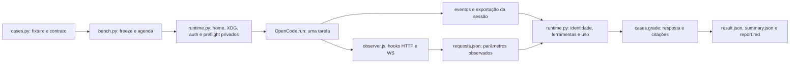

# Grounding para exploração Haiku 5.5

Leitura feita em 2026-10-11, sem executar OpenCode, inferência, rede ou Docker. Apliquei `how` e li `references/explainer-prompt.md`; esta tarefa é o papel de explainer delegado. Toda a análise foi feita por GPT. O único arquivo escrito foi este documento. O usuário confirmou código e arquivos do projeto, como antes. O escopo fechado é de seis casos originais, cinco repetições, cinco esforços, 150 trials comparativos e cinco smokes.

## Visão geral

O pacote de exploração é um executor sequencial de tarefas sintéticas de leitura de código. `cases.py` cria o mesmo serviço Python em cada sessão e define a pergunta, resposta literal e evidências necessárias. `bench.py` congela a agenda, prepara cada execução privada, invoca o OpenCode e corrige o JSON final. `runtime.py` controla configuração, credenciais, descoberta, identidade e ferramentas. `observer.js` verifica o que o OpenCode envia ao provider sem mudar a requisição.

A base recomendada é `exploracao/sol-fast-vs-deepseek/results/pilot-r2-xhigh-gemini/frozen-source`. Conferi seus sete arquivos de código e o README contra os hashes do `freeze.json` da rodada. Todos coincidem. Os 23 arquivos de `cases.FILES` também reproduzem `fixture_sha256`. Os sete arquivos de código ativos no pacote original continuam com os mesmos bytes desta base. Uma cópia isolada permite mudar a coorte sem alterar corpus, fontes nem resultados antigos.

## Contrato e agenda

Os seis casos são `route`, `config`, `retry`, `permission`, `feature` e `absence`. Cobrem caminho ativo até o transporte do banco, precedência com ambiente vazio, fronteira de retries, autorização, flag de tenant desativada e ausência de rota ativa apesar de código legado plausível. Não há pesquisa web nesta suíte.

O agente `navigator` recebe uma mensagem, até 25 passos e somente `read`, `glob`, `grep` e `list`. Shell, edição, web, skills e subagentes ficam negados. Cada passo pode produzir várias chamadas e o OpenCode pode fazer retries internos. Eles permanecem no tempo e nos eventos.

`schedule()` embaralha os 30 blocos de caso e repetição usando a seed `20261010`; uma ordem base com rotações balanceia a posição dos candidatos. Cinco esforços resultam em 150 trials, 30 por esforço. Como 30 é divisível por cinco, cada esforço ocupa cada posição seis vezes. O smoke `route`, uma repetição e cinco esforços produz mais cinco sessões, em saída separada. Não há retries automáticos do executor.

O limite individual é 300 segundos. O orçamento global padrão é 21.600 segundos, conferido entre trials. Uma execução iniciada pode ultrapassar esse orçamento até seu timeout, mais preparação e exportação. Para os 150 trials, o teto de timeout agregado sozinho é 45.000 segundos; o padrão de seis horas pode deixar trials não iniciados. O orçamento deve ser escolhido e congelado explicitamente, sem alterar o limite individual durante a rodada.

`plan`, `preflight` e `run` exigem uma pasta nova. `plan` não é entrada de `run`; cada `run` gera seu próprio freeze e preflight. `report` lê os candidatos e a agenda do freeze existente, sem inferência.

## Preflight privado e guards

`private_env()` cria home de descoberta e XDG privados, desabilita configuração do projeto e atualização do catálogo, e limita as variáveis herdadas. `prepare()` copia o catálogo, configura o observador, exige exatamente `opencode v2.0.26` e importa uma cópia da credencial CLIProxy. O banco original é aberto com SQLite `mode=ro`; o arquivo temporário de importação usa modo `0600` e é removido. O banco privado é removido ao concluir o trial. O pacote de exploração não depende do Docker.

`audit()` sobe um servidor local privado e consulta integração, configuração, skills, plugins e modelos. Exige uma fonte documental de configuração dentro do runtime privado, nenhum skill e somente o plugin local `navigation-observer`, além dos plugins builtin. Confere origem, ativação e registro `ready` do observador. Resolve o modelo, `modelID`, variante e esforço. O preflight declara zero chamadas e rejeita qualquer requisição de modelo observada. Disponibilidade local de uma variante não prova sua tradução a montante; o smoke verifica os parâmetros enviados.

`manifest()` congela hashes de todos os `.py` locais e de `observer.js`, README, catálogo, fixture, prompts, candidatos, agenda, timeout e orçamento. `check_freeze()` confere código, protocolo e catálogo antes de cada trial. `run_trial()` compara a fixture inteira no `finally`; alteração vira `scope_violation`. Qualquer `infra_error` ou `scope_violation` para a rodada, mantendo os próximos trials como `not_run`. Resposta incorreta, `task_error` e `timeout` continuam para os próximos trials.

Há duas lacunas relevantes para o pacote novo. A base não confere fontes depois do último trial e não registra hash do executável OpenCode. A cópia nova deve registrar sua proveniência, verificar os hashes herdados antes de copiar, manter `cases.py` e `test_cases.py` byte a byte, e conferir guardas no início e no fim de cada fase. Se houver um runner fora do diretório do harness, ele precisa entrar no manifesto da rodada. Um inventário independente dos arquivos antigos, excluindo o pacote novo, permite demonstrar sua preservação.

## Formato e correção

`prompt()` exige somente um JSON com exatamente `answer` e `evidence`. `answer` tem campos, valores e tipos estritos; booleanos não substituem inteiros. `evidence` contém de uma a oito entradas com exatamente `path`, `symbol`, `line` e `quote`. O caminho precisa pertencer à fixture, a linha usa base um e a citação deve reproduzir a linha inteira, incluindo indentação. O símbolo precisa conter essa linha no AST. Todas as âncoras exigidas pelo caso precisam estar presentes.

`grade()` devolve `passed`, `answer_correct`, `evidence_correct` e os checks de JSON, formato, fixture, validade e âncoras. Assim, uma resposta literal correta pode reprovar pelas citações. Isso faz parte do contrato original. Não é um corretor de explicação aberta, navegação útil ou pesquisa web.

`parse_session()` exige uma sessão, uma mensagem do usuário, assistentes sempre com o modelo, variante e agente pedidos, idle terminal `succeeded`, texto final e ferramentas permitidas. Soma entrada, saída, raciocínio e cache separadamente. Na base, ele não conserva `finish` nem `rawFinish` e não distingue `length` de uma conclusão normal. No trial antigo de implementação `trial-0008`, confirmei diretamente `finish=length`, `rawFinish=max_tokens`, 32.768 tokens de raciocínio, zero de saída e idle `succeeded`. Isso justifica diagnóstico separado de limite de saída.

## Observação e exportação

O observador registra identidade, sessão, agente, chamada, rota sem query, modelo, esforço, tipo de thinking, limite enviado, uso, HTTP status e tempos. Não grava headers, credenciais, prompts ou ferramentas nesse log. Os hooks HTTP entregam os mesmos bytes ao consumidor enquanto observam o stream. O limite de 2 MiB protege somente a leitura de metadados por evento SSE ou corpo JSON não SSE; não corta o stream entregue ao OpenCode.

`verify_requests()` exige `claude-haiku-5-5`, esforço pedido, identidade da variante, agente `navigator`, chamada `primary`, rota `http://127.0.0.1:8317/v1/messages` e `thinking.type=adaptive`. Isso verifica o pedido encaminhado, não qual modelo o CLIProxy executou a montante nem quanto raciocínio ele realizou.

A exportação atual usa `runtime.command()`, que chama `Popen` com stdout e stderr em PIPE e `communicate()`. Não existe cap de captura nesse helper. `bench.run_trial()` salva o stdout sanitizado como `session.json` antes de fazer `json.loads`, portanto essa base preserva um export inválido. O pacote de implementação que falhou não preservou o stdout bruto. A hipótese de saída CLI não drenada tem apoio em reprodução sintética, mas não está provada no binário 2.0.26. O coordenador também reproduziu `Bun stdout.write` seguido de `process.exit` com stdout em arquivo regular: o JSON de 1.000.014 bytes ficou íntegro, sem rede ou modelos. Essa prova orienta o controle novo e continua sendo uma reprodução sintética.

Para reduzir esse risco na nova rodada, a chamada de exportação deve escrever stdout diretamente em arquivo regular aberto pelo executor, sem shell. O processo mantém `start_new_session`, timeout de 45 segundos e encerramento do grupo em timeout. Após o processo terminar, o executor lê e sanitiza os bytes, conserva a exportação antes de tentar parsear e registra exit code, timeout, tamanho, SHA-256 e erro JSON com offset. O arquivo temporário bruto precisa de modo `0600`; o artefato preservado mantém todos os bytes não secretos. Uma exportação inválida continua sendo `infra_error`; não se converte em nota zero de capacidade e não dispara outra inferência. Uma nova exportação da mesma sessão, se necessária para diagnóstico, deve ter nome próprio e preservar a primeira.

## Hooks mínimos do pacote novo

1. Em `runtime.py`, registrar somente `haiku-low`, `haiku-medium`, `haiku-high`, `haiku-xhigh` e `haiku-max` como coorte padrão. Usar provider `cli_proxy`, modelo local `cpa-claude-haiku-5-5`, wire model `claude-haiku-5-5`, protocolo `messages`, credencial `cli_proxy`, auth `key` e Fast falso. O cadastro já usado no pacote isolado de implementação mostra exatamente esses campos.
2. Em `configuration()`, cadastrar explicitamente as cinco variantes com `settings.effort` igual ao ID. O pacote de implementação já faz isso. O audit existente lê esse campo para protocolo messages. Conservar canonical `anthropic`, pacote provider e baseURL.
3. Fixar `limit.output=128000` para todos os cinco esforços e registrar esse controle no freeze e README. O coordenador confirmou o máximo de saída 128K na documentação Anthropic. Conservar contexto 272.000, 25 passos e timeout 300. O smoke deve demonstrar o `max_tokens` realmente enviado; o valor de configuração sozinho não comprova o limite efetivo. Acrescentar a verificação do limite enviado a `verify_requests()` evita comparar esforços com caps diferentes.
4. Criar uma captura específica de export para arquivo regular e preservar diagnósticos completos. O helper geral `command()` pode continuar servindo o run, a versão e as APIs. Isso limita a mudança ao caminho que precisa dela.
5. Em `parse_session()`, conservar `finish` e `rawFinish` de todos os assistentes e o último finish, antes de levantar qualquer `TaskFailure`. Registrar `output_limit_reached` quando `finish=length` ou `rawFinish=max_tokens`. O grader original continua dando resposta e evidência; a análise distingue entrega incorreta, esgotamento de saída, timeout e infraestrutura. Para diagnóstico nativo adicional, `observer.observe()` pode guardar somente os campos de fim selecionados, incluindo `body.delta.stop_reason` no SSE Anthropic.
6. Manter `cases.py` e `test_cases.py` sem deltas. Ajustar os testes de registry e configuração da cópia nova, porque os antigos exigem sete candidatos padrão e ausência de variantes Anthropic explícitas. Acrescentar provas comportamentais da agenda 150, cobertura dos cinco esforços, captura grande em arquivo, export inválido preservado e diagnóstico `length`. O `test_observer.mjs` está no pacote ativo, mas não na cópia frozen R2; se for reutilizado, registrar sua origem separadamente.

Os seis casos atuais suportam leitura, busca e exploração de código local. O usuário fechou o escopo nesses casos, sem web.

## Onde procurar

Todas as referências abaixo apontam para a base congelada.

| Arquivo | Pontos de entrada |
|---|---|
| `bench.py` | `schedule` linha 22; `manifest` 42; `check_freeze` 66; `run_trial` 83; `preflight` 173; `report` 235; `main` 311 |
| `runtime.py` | `Candidate` 23; `command` 75; `private_env` 96; `configuration` 108; `prepare` 171; `audit` 238; `verify_requests` 333; `parse_session` 371 |
| `cases.py` | `FILES` 10; `CASES` 214; `build` 296; `prompt` 306; `grade` 352 |
| `observer.js` | `requestMetadata` 30; `observe` 75; `wrap` 89; callbacks 162 |
| `test_cases.py` | respostas de referência e provas positivas/negativas do contrato e execução da fixture |

Os resultados são um piloto descritivo com seis problemas, cinco repetições e cache remoto possível. A mediana geral do relatório inclui conclusões incorretas; comparações pareadas exigem os dois esforços aprovados no mesmo caso e repetição. Alterar saída para 128.000 identifica uma nova configuração experimental, portanto seus números não devem ser misturados com rodadas sob 32.768.
