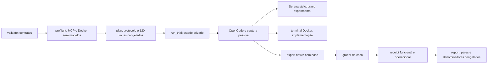

# Julgamento cruzado: Haiku com Serena no OpenCode

Leitura: `work.md`, `design-a.md`, `design-b.md` e `grounding.md`, `grounding-a.md`, `grounding-b.md`, todos deste diretório. Esta revisão avalia os desenhos; não constitui prova de instalação, integração ou resultado experimental. Nenhuma inferência foi iniciada e nenhuma fonte ou evidência anterior foi alterada.

Limitação da arena: os modelos disponíveis pertencem somente à família GPT. Este juiz usa o GPT herdado do orquestrador. Há separação de tarefas e leitura independente, mas não diversidade de famílias Claude/Grok; não atribuir ao julgamento uma concordância multifamília.

## Notas pela régua congelada

Escala: 0 = requisito ausente ou conflito estrutural; 1 = atende parcialmente, com correção concreta necessária; 2 = desenho suficiente para orientar a implementação e sua prova.

| Critério de `work.md` | A | B | Evidência e implicação |
| --- | ---: | ---: | --- |
| 1. Comprovar identidade, esforço, isolamento e uso efetivo do MCP | 1 | 2 | A preserva identidade/wire e exige catálogo real, mas deixa provisionamento LSP e parte da configuração herdada como questão aberta. B especifica fingerprint da instalação editable, remoção de `base_modes`, dependências offline, chamadas reais de símbolo/referência/edição, ferramentas úteis separadas de instruções e limite do isolamento host. Esses pontos continuam sujeitos ao preflight real. |
| 2. Comparação pareada com mesmos casos, limites e corretor | 2 | 1 | Ambos mantêm os mesmos contratos, ordem intercalada e execuções sequenciais. A explicita corretamente 15 trials por papel/configuração. B diz relatório por papel com aprovação `/30 por configuração`: o denominador correto nesse recorte é 15; 30 vale para os dois papéis juntos. Corrigir antes de congelar o relatório. |
| 3. Reutilizar contratos corrigidos e preservar evidências anteriores | 2 | 2 | Ambos usam os três casos exploratórios e os três TaskSpec corrigidos, preservam aceite privado e reaplicação limpa do patch, e isolam cópias locais das suites anteriores. B torna explícitos os hashes/proveniência e evita importar módulos mutáveis de resultados. |
| 4. Falhas de infraestrutura distintas de reprovação funcional | 1 | 2 | A reconhece que erro MCP não é erro funcional, mas não fecha a política de interrupção e recebimento de evidência incompleta. B identifica identidade incorreta, LSP indisponível e escape de escopo como bloqueios de infraestrutura, sem transformar reprovação funcional em gate de admissão. O resultado precisa registrar campanhas interrompidas como incompletas. |
| 5. CLI pequena, executável e verificável sem inferência | 2 | 1 | A oferece `validate`, `preflight`, `plan` e `run`, com smoke opcional. B expõe `--phase` e `--smoke-proof` e exige uma campanha extra com modelos antes do full. As provas de infraestrutura sem inferência já podem cumprir esse gate; o smoke deve ser opcional e separado. |
| **Total** | **8/10** | **8/10** | Empate decidido pela profundidade das fronteiras e menor API interna. |

## Base escolhida

Escolher **B**, com as correções abaixo. Sua interface interna principal é `plan(protocol)`, `run_trial(protocol, trial)` e `report(protocol, receipts)`. O protocolo possui configuração, fontes, instalações e limites; o runtime possui o ciclo de vida de OpenCode/MCP; o caso possui seu contrato e corretor. Assim o chamador pede um trial e recebe evidência, sem coordenar preparação, auditoria, sessão e grader como etapas públicas.

O desenho A tem uma CLI externa melhor, mas apresenta nove funções de alto nível e propõe ampliar um loop cujo contrato pressupõe leitura e fixture inalterada. Um novo loop misto local evita espalhar exceções desses invariantes. Isso não autoriza reescrever captura ou graders estáveis: B deve copiar apenas as primitivas necessárias, com hashes, e manter um proprietário do loop.

Os desenhos convergem em um scheduler, uma união de casos, captura passiva, baseline novo intercalado, terminal Docker, MCP stdio por trial e ausência de framework de adapters. Não houve dropout entre os dois artefatos recebidos.

## Enxertos e correções

1. **De A: CLI sem smoke obrigatório.** Expor `validate`, `plan`, `preflight` e `run`; `validate`, `plan` e `preflight` não chamam modelos. `run` usa a agenda congelada de 120 trials. Se houver smoke, ele é uma opção explícita, em destino novo, fora do denominador principal; nenhuma taxa de aprovação do smoke admite ou rejeita o full. O preflight sem inferência fornece a prova obrigatória de infraestrutura.
2. **De A: contagem e denominadores explícitos.** São seis casos × cinco repetições × dois esforços × dois braços = 120 trials. Cada papel tem 60 trials, cada configuração tem 30 no total e 15 por papel. Há 30 pares com/sem Serena por esforço, 15 por papel/esforço e 60 pares no total. São seis problemas distintos com repetições operacionais; não são 120 tarefas independentes.

Preservar de B o provisionamento offline, configuração global privada, tabela única de ferramentas, manifesto da instalação real e gates de infraestrutura. Preservar de A a comparação temporal do conjunto completo com seus status, além do recorte de pares ambos aprovados; a seleção por aprovação não pode desaparecer do relatório.

Não aceitar automaticamente a lista maior de B: `rename_symbol`, `safe_delete_symbol` e diagnostics só entram se necessários aos casos e provados na instalação real. A lista mínima comprovada gera contexto, permissões e parser. Uma ferramenta sem prova não se torna parte do tratamento porque aparece no desenho.

Rejeitar o wrapper de dois runners, a obrigatoriedade de smoke com inferência, um framework de plugins/adapters e a abertura de shell host. Não combinar dois loops nem manter interfaces antigas em paralelo dentro do pacote novo.

## Overview

O novo pacote mede Haiku 5.5 medium/high em dois papéis: pesquisar código e implementar mudanças. Em cada caso/repetição, compara uma sessão OpenCode com as ferramentas nativas definidas para o papel e outra sessão com a mesma política acrescida das ferramentas e instruções Serena. O efeito atribuído é desse pacote Serena; o experimento não separa causalmente LSP, instruções e ferramentas.

O protocolo é a unidade congelada do experimento. Ele determina identidade `cli_proxy/cpa-claude-haiku-5-5`, wire `claude-haiku-5-5`, thinking adaptive, esforço, cap inteiro 128000, seis contratos, limites por papel, superfície de ferramentas e fingerprints. As coortes históricas fornecem contratos corrigidos e primitivas, não a baseline temporal ou funcional desta comparação.

## Key Concepts

- `Protocol`: fontes e contratos congelados, instalações comprovadas, limites e configurações.
- `Case`: união exploração/implementação; o próprio caso determina seu papel, fixture, permissão e grader.
- `Trial`: caso, repetição, esforço e braço; não carrega um papel independente que possa divergir do caso.
- `Receipt`: evidência de identidade, entrega, sessão, ferramentas, tempos, resultado funcional e estado operacional. Ausência de evidência obrigatória precisa aparecer como falha de infraestrutura.
- Bloco pareado: mesmo caso/repetição com quatro configurações, alternando e balanceando posições com seed fixo. Os modelos executam sequencialmente.

## How It Works

Primeiro `validate` comprova os contratos: baseline satisfaz compilação/regressão e falha no aceite relevante; referência satisfaz todos os gates; os JSONs de referência satisfazem resposta e citações. O aceite privado permanece no diretório de grading confiável, fora do workspace entregue ao agente.

Depois `preflight` inicia o launcher Serena local em stdio sobre uma fixture descartável. Ele lê `tools/list`, executa buscas de símbolo/referência e edição permitida, comprova LSP Python offline e confinamento de paths, e verifica a superfície final do OpenCode 2.0.26. Conexão MCP isoladamente não basta. A prova usa projeto e estado próprios e não aquece os trials medidos.

`plan` congela a agenda intercalada de 120 linhas com os mesmos casos, prompts, limites e corretor entre os braços. O manifesto fixa fontes, instalação editable realmente carregada, dependências e cache compartilhável de distribuição, imagem Docker, ferramentas e schema observado no binário instalado. Alteração desses elementos invalida a admissão daquela execução.

Para cada linha, `run_trial` cria projeto, HOME/XDG, `OPENCODE_TEST_HOME`, `SERENA_HOME`, temporários, metadados e logs privados. No braço Serena, o próprio OpenCode inicia o MCP stdio com projeto único e contexto mínimo. No braço nativo, essa integração não inicia. Memórias, índices e configuração mutável não são compartilhados entre trials. Dependências imutáveis pré-provisionadas podem usar cache declarado e congelado.

O relógio principal começa no spawn de OpenCode e inclui boot MCP/LSP, ferramentas, retries e resposta. O observador passivo registra requests e comprova modelo/esforço/wire. A exportação nativa precisa ser arquivo regular com hash. Preparação, exportação e grading têm regiões próprias; prontidão MCP só recebe um número quando há marcador confiável.

O caso decide a validação funcional. Exploração exige o contrato estrito de JSON/citações e fixture inalterada. Implementação coleta somente o patch permitido, preserva testes públicos e reaplica o patch numa cópia limpa; compilação, regressão e aceite executam no container de grading separado e sem rede, exigindo marcador de conclusão. O terminal do agente também executa no Docker sem rede.

O relatório usa todos os trials do braço Serena, inclusive aqueles sem chamada útil. Ele separa resposta/citação, patch/escopo, compilação/regressão/aceite, erros operacionais e infraestrutura. Identidade incorreta, escape ou falta de prova necessária interrompem a campanha e produzem estado incompleto; não somem do denominador nem viram reprovação funcional. Aprovação e tempos são apresentados por papel/esforço/braço e pelos pares previstos no manifesto.

## Where Things Live

Mapa recomendado, ainda sujeito à implementação:

| Local no pacote novo | Responsabilidade |
| --- | --- |
| `bench.py` | CLI, agenda, loop sequencial e relatório; chamadores veem o protocolo, trial e receipt. |
| `runtime.py` | Ambiente privado, configuração OpenCode/Serena, subprocessos, captura, exportação e parsing. |
| `cases.py` | Os seis contratos e sua união, materialização, escopo e dispatch de corretor. |
| `vendor/` | Somente primitivas estáveis necessárias, congeladas e com proveniência; sem outro scheduler. |
| Contexto/modo Serena e `terminal.js` locais | Superfície exata de ferramentas e terminal Docker; gerados ou verificados pela mesma política. |
| `validation/` | Provas sem inferência, fontes da decisão e evidência de integração. |
| Destino novo de resultados | Manifesto, agenda, artefatos por trial e relatório da nova comparação. |

## Gotchas

- O schema do binário OpenCode 2.0.26 prevalece sobre documentação/SDK de outra versão. Congelar e provar a configuração concreta antes de modelos.
- Serena editable exige hash das fontes/resources e pacotes efetivamente carregados; `2.0.0.dev0` não identifica sozinho a instalação.
- `--mode` não remove modos globais herdados. `SERENA_HOME` privado precisa ter `base_modes` e defaults definidos explicitamente.
- Terminal e grader têm isolamento Docker. Serena e LSP em host têm confinamento por projeto/configuração, cujo alcance precisa de prova; não há promessa de namespace OS equivalente.
- `initial_instructions` e configuração não são uso útil de Serena. Ausência de uso útil não remove o trial nem impede aprovação funcional.
- Metadados Serena ficam fora da fixture. Isso evita inventar uma exceção no coletor de patch para alterações administrativas.
- Citações do corretor usam linhas 1-based; as ferramentas Serena podem fornecer coordenadas 0-based. O mesmo contrato explícito vale para ambos os braços.
- Limites de implementação vêm do protocolo corrigido e devem aparecer no freeze. Não aplicar silenciosamente o limite exploratório de 300s/25steps ao outro papel.
- Erro MCP/LSP, limite operacional e reprovação do caso têm naturezas diferentes. Registrar o evento real e a incompletude da campanha antes de qualquer cálculo comparativo.

Doc impact: pending — a implementação deve tornar os comandos, denominadores, isolamento e gates acima verdadeiros no README do pacote; esta revisão só escreve o artefato autorizado.

## Verificação do julgamento

Os dois desenhos foram lidos integralmente e pontuados nos cinco critérios registrados em `work.md`. A aritmética da agenda e dos pares foi conferida. A integração proposta permanece não comprovada até os gates sem inferência; este julgamento não declara o eval pronto para executar modelos.
